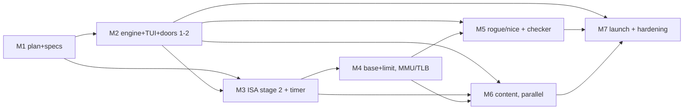

# AmmaBoard — detailed plan: PoC → MVP → beta

Written 2026-10-16. Companion docs: PLANNING.md (decisions), poc.md (PoC scope, DONE),
motherboard.md (machine architecture), ui.md (TUI design).

**Goal: beta launch Dec 1 2026 — doors 1–11** (8 chapters, through *your own MMU*).
Today = 46 days out. Full 16 chapters = Dec 2027. Machine name per motherboard.md §2:
**AmmaBoard-{generation}**, generation = ISA stage (this PoC = AmmaBoard-1, boot ten).

---

## 0. Status snapshot (2026-10-16)

| Exists | Missing |
|---|---|
| Motherboard: broker, phased clock, event-sourced tick log | Chapter engine (`internal/chapters`) |
| Boot-ten ISA + two-pass assembler + `examples/counter.amm` | TUI (`internal/ui`, bubbletea) |
| SQLite log + `trace.txt` export, BOOT/FROZEN snapshots | Progress save, date-gating, release build |
| `TestDeterminism` (byte-identical event streams) | ISA stages 2–3; timer + interrupt controller |
| Fault plumbing dormant in CPU (`Fault` in execute loop) | Base+limit, status reg, trap vector, MMU/TLB |
| Pluggability: `EchoDevice` via one `Attach` | Rogue/nice payloads + acceptance checker |
| CLI: defaults `ammaboard.db` / `trace.txt`, `-echo`, `-max` | Primers + rest-day reading sets (doors 1–11) |

---

## 1. Milestones

| # | Milestone | Window | Depends on |
|---|---|---|---|
| M1 | Plan + specs locked | by Oct 23 | — |
| M2 | Chapter engine + TUI shell + doors 1–2 | Oct 24 – Nov 8 | M1 |
| M3 | ISA stage 2 + timer/interrupt controller + chapters 4/5/7/8 | Oct 27 – Nov 15 | M1, M2 (engine) |
| M4 | Day 10–11 machine: base+limit, privilege, MMU/TLB | Nov 2 – Nov 20 | M3 |
| M5 | Rogue/nice payloads + acceptance checker | Nov 14 – Nov 24 | M2, M4 |
| M6 | Content: primers + readings + source checks (parallel, per door) | Oct 27 – Nov 24 | door runnable |
| M7 | Launch plumbing + hardening + **beta Dec 1** | Nov 17 – Nov 30 | M2–M6 |

Slack: ~6 days between M4/M5 end and launch. The date is hard (advent); honest slip =
`--free` mode + days 12+ shipped as labeled locked doors ("unlocks 2027"), never broken doors.

### M1 — Plan + specs locked (by Oct 23)
Ratify this plan; close the decisions in §2 below (TLB granularity, payload header, editor
scaffolding, launch repo). Nothing in M3/M4 may start on an open decision. **Done when**: all
four §2 rows have a decision recorded in their home doc.

### M2 — Chapter engine + TUI shell + doors 1–2 (storefront; Oct 24 – Nov 8)
Doors 1–2 need **zero ISA** (plugboard patch; card-deck reorder) — pure engine/UI work, so
this starts before any machine growth and produces the screenshots risk #2 demands.
- `internal/chapters`: data-driven chapter = payload binaries + initial machine config +
  expected snapshots/traces + primer + curated links (session 5 format).
- `internal/ui` (ui.md): door grid (date-gated, `--free`), narrative pane, machine view
  (registers + memory grid), tick-log pane; exercise editor lands with day 4–5 work.
- Acceptance: fresh clone → one command → door 1 playable end-to-end; screenshots exist.

### M3 — ISA stage 2 + timer/interrupt controller + chapters 4/5/7/8 (Oct 27 – Nov 15)
Pain-driven: nothing here before its chapter needs it (ISA rule, PLANNING.md).
- 9 instructions (poc.md §1 stage 2): `load_byte store_byte shift_left shift_right
  shift_right_arithmetic bit_and bit_or allow_interrupts forbid_interrupts
  return_from_interrupt` (own opcode — session 10 decision).
- Status register with **IE** flag (priv bit waits for M4). Timer + interrupt controller
  device (day 8); interrupt entry/return through the dormant fault plumbing path.
- Assembler sugar layer (`nop mov ret li jump …`) as real encodings expanding to primitives —
  shipped only after the learner hand-expands each once (day 5).
- Acceptance: chapters 4, 5, 7, 8 playable; golden-trace test per chapter (diffable
  `SELECT * FROM events`, extends `TestDeterminism`).

### M4 — Day 10–11 machine (Nov 2 – Nov 20)
- Base+limit unit (day 10) — pure hardware, no new instructions.
- Privilege bit added to the status register; page-walk runs privileged.
- Trap vector + fault register (type, vaddr, pc) — wakes the PoC's dormant plumbing; faults
  stay first-class data (kind, pc, addr, phase).
- Page-table walker + TLB + `flush_tlb` (day 11); walk authored by the learner in toy ISA,
  consulted as a privileged routine (poc.md §2).
- Acceptance: day-10 "two programs collide → add base+limit" and day-11 "your own MMU"
  playable to clean halt.

### M5 — Rogue/nice payloads + acceptance checker (Nov 14 – Nov 24)
One payload pair, reused: day-10 limit-violation, day-11 page-fault (session 5 ramp).
- Checker = dual criteria (behavior + snapshot diff), fault events as data
  (kind/faulting-pc/vaddr), loose ~10× cycle budget.
- Acceptance: rogue faults with the expected kind/pc; nice exits clean (the ui.md foot line:
  "goal: rogue faults, nice exits 0" goes green).

### M6 — Content (parallel, Oct 27 – Nov 24)
Per playable door: primer (pain → invention → mechanic, history ≤30%) + 2–4 curated links +
rest-day reading set (3, 6, 9, 12; day-12 BSOD buffer if slack). Every primer gets the
20-min source-check pass (risk #3). Primers ship **with** the door, not after.

### M7 — Launch plumbing + hardening (Nov 17 – Nov 30; beta Dec 1)
- Date-gating + `--free`; `internal/progress` (state file under user config dir).
- Single static binary via GitHub Releases; `amma` short alias (motherboard.md §2);
  self-update optional, cut first if late.
- Golden-trace CI per chapter; full doors 1–11 playthrough by a non-author; days 12+ render
  as labeled locked doors.
- Launch comms (Show HN, r/programming, AoC-adjacent) designed as a deliverable, not an
  afterthought (risk #5).

---

## 2. Open decisions (gate the milestones above)

| Decision | Blocks | Decide by | Default if unforced |
|---|---|---|---|
| TLB granularity: per-1KB-page only, or + "walk always" debug mode (poc.md §4.2) | M4 | Nov 1 | Per-1KB only + debug flag |
| Payload header layout: `origin, length, entry` field order/width/endianness | M3, M5 | Oct 31 | Fixed 12-byte header, little-endian, spec'd in motherboard.md |
| Day 4–5 exercise editor scaffolding (persona detail, session 5 remainder) | M2, M3 | Nov 1 | Plain text input + step/run, no syntax frills |
| Launch repo name + self-update mechanism | M7 | Nov 15 | Repo named for the machine; self-update deferred |

## 3. Standing rules (from PLANNING.md — unchanged by this plan)

1. Content velocity is the project; the engine is ~30% of the work. M2–M4 exist to make a
   new chapter cheap (template + component reuse), never as ends in themselves.
2. ISA grows only when a chapter's pain demands it — M3/M4 are sequenced to their chapters.
3. Determinism by construction: single-threaded tick loop, seeded nothing, event-sourced;
   every milestone's acceptance is a diffable trace, never a vibe.
4. Numbers and grids, never animation (TUI viz ceiling).
5. If the calendar slips: ship doors 1–8 polished over 1–11 rushed, rest behind `--free`.
